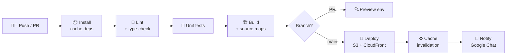
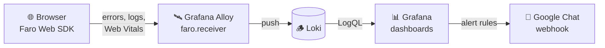

<!-- Header -->
<p align="center">
  
</p>

<p align="center">
  <a href="https://github.com/liamvietpham">
    
  </a>
</p>

<p align="center">
  <a href="https://liamvietpham.github.io/"></a>
  
  <a href="https://github.com/liamvietpham?tab=followers"></a>
</p>

---

## 👋 About me

```ts
const viet = {
  role: "Fullstack Developer",
  location: "Vietnam 🇻🇳",
  certifications: [
    "AWS Certified Solutions Architect – Associate (SAA-C03)",
    "AWS Certified Developer – Associate (DVA-C02)",
  ],
  frontend: ["Vanilla JS", "React", "Preact", "Next.js", "Vue.js", "Angular"],
  backend: ["Express.js", "Bun", "NestJS", "PHP Symfony"],
  cloud: ["AWS", "CI/CD for frontend", "Docker"],
  observability: "Faro → Alloy → Loki → Grafana → Google Chat",
  motto: "Ship fast, observe everything, sleep well.",
};
```

- 🧩 I build products **end to end**: from pixel-perfect UIs to APIs, infrastructure and monitoring.
- ☁️ **AWS certified ×2**: I design systems that are secure, scalable and cost-aware.
- 🔁 I set up **CI/CD pipelines for frontend apps** so every merge ships safely.
- 📡 I run **real-user monitoring** with the Grafana stack, with alerts going straight to the team's chat.
- 🌱 Currently exploring: serverless NestJS on Lambda, microservices and AI-powered tools.

---

## 🏅 Certifications

<p align="center">
  
  
</p>

| Certification | Code | What it covers |
| :-- | :--: | :-- |
| 🟧 **AWS Certified Solutions Architect – Associate** | `SAA-C03` | Resilient, high-performing, secure and cost-optimized architectures (VPC, EC2, ALB, Auto Scaling, RDS, S3, CloudFront, Route 53, IAM) |
| ⬛ **AWS Certified Developer – Associate** | `DVA-C02` | Building and deploying on AWS (Lambda, API Gateway, DynamoDB, SQS/SNS, Cognito, CodePipeline/CodeBuild, CloudWatch, X-Ray) |

---

## 🛠️ Tech stack

### 🎨 Frontend
<p>
  
</p>
<p>
  
  
  
  
  
  
</p>

### ⚙️ Backend
<p>
  
</p>
<p>
  
  
  
  
</p>

### 🗄️ Databases & caching
<p>
  
</p>

### ☁️ Cloud & DevOps
<p>
  
</p>
<p>
  
  
  
  
  
</p>

### 📡 Observability
<p>
  
  
  
  
  
</p>

---

## 🔁 Frontend CI/CD

Every pull request and merge goes through an automated pipeline before it reaches users:



---

## 📡 Real-user monitoring pipeline

Errors, logs and Web Vitals are collected from real users' browsers and turned into alerts the team sees within seconds:



| Stage | Tool | Role |
| :-- | :-- | :-- |
| 1 | **Grafana Faro** | Web SDK in the frontend that captures JS errors, console logs, Core Web Vitals and sessions |
| 2 | **Grafana Alloy** | Receives Faro payloads, processes and labels them, then forwards them |
| 3 | **Loki** | Stores the logs and makes them queryable with LogQL |
| 4 | **Grafana** | Dashboards for error rate, Web Vitals and releases, plus alert rules |
| 5 | **Google Chat webhook** | Delivers alerts to the team's space so incidents are spotted right away |

---

## 🚀 Featured projects

<p align="center">
  <a href="https://github.com/liamvietpham/nestjs-microservices"></a>
  <a href="https://github.com/liamvietpham/nest-api-lambda-demo"></a>
  <a href="https://github.com/liamvietpham/node-express-microservices"></a>
  <a href="https://github.com/liamvietpham/thumbgenai"></a>
  <a href="https://github.com/liamvietpham/mini-php-framework"></a>
  <a href="https://github.com/liamvietpham/my-ui-library"></a>
</p>

---

## 📊 GitHub stats

<p align="center">
  
  
</p>

<p align="center">
  
</p>

<p align="center">
  
</p>

---

## 🤝 Let's connect

<p align="center">
  <a href="https://liamvietpham.github.io/"></a>
  <a href="https://github.com/liamvietpham"></a>
</p>

<!-- Footer -->
<p align="center">
  
</p>
